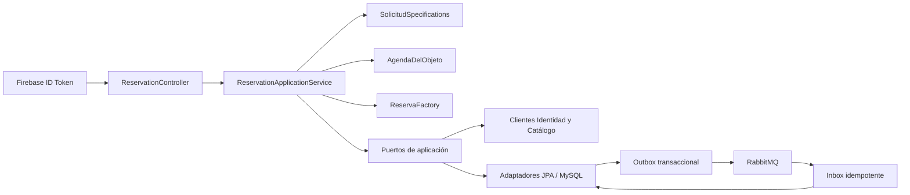

# Arquitectura

## Alcance

Reservas posee `solicitudes`, `reservas`, `agendas_objeto`, outbox, inbox y auditoría. Los UUID de publicación y usuarios son referencias externas; la migración no crea claves foráneas a otros contextos. No se leen ni escriben tablas de Identidad, Catálogo, Préstamos, Pagos o Notificaciones.

La organización sigue puertos y adaptadores:

- `domain`: periodo semiabierto, condiciones inmutables, `SolicitudSpecifications`, `AgendaDelObjeto`, `ReservaFactory` y transiciones.
- `application`: casos de uso y puertos explícitos de persistencia, Catálogo, Identidad, outbox y auditoría.
- `infrastructure`: JPA/MySQL, REST con timeouts, Firebase Admin, RabbitMQ y relay.
- `interfaces/rest`: DTOs explícitos, validación y traducción de errores.

## Concurrencia

Aceptar una solicitud abre una transacción breve: bloquea la solicitud, inicializa de forma idempotente la agenda mediante `INSERT IGNORE` en un bootstrap `REQUIRES_NEW` corto y bloquea la agenda con `PESSIMISTIC_WRITE`. La separación del bootstrap evita los deadlocks de gap/unique locks observados con 20 primeras aceptaciones simultáneas; una agenda vacía remanente tras rollback es inocua. Bajo el lock, el adaptador obtiene en una consulta los intervalos `CONFIRMADA` y `CANCELACION_PENDIENTE`; `AgendaDelObjeto` aplica `existente.desde < nuevo.hasta AND existente.hasta > nuevo.desde`. `ReservaFactory` valida agenda/publicación/estado y crea el snapshot de dominio. La reserva, transición de solicitud, auditoría y Outbox sí comparten la transacción principal. No hay HTTP dentro del lock y `solicitud_id` sigue siendo único.

## Consistencia distribuida

La confirmación publica `ReservaConfirmada` mediante outbox. La solicitud de cancelación conserva el periodo bloqueado y publica `CancelacionReservaSolicitada`. Solo `PrestamoCancelado` cambia la reserva a `CANCELADA`; `CancelacionRechazada` la devuelve a `CONFIRMADA`. `PeriodoPrestamoLiberado` puede acortar un intervalo futuro. Inbox deduplica `event_id` y `aggregate_version` evita aplicar mensajes atrasados.

RabbitMQ ofrece entrega al menos una vez, no exactamente una vez. El relay reclama lotes en una transacción corta mediante `FOR UPDATE SKIP LOCKED`, publica fuera del bloqueo con mandatory routing/publisher confirms y marca el resultado en otra transacción. Los leases vencidos son recuperables y no se adelanta una versión sobre otra pendiente del mismo agregado. Un crash después de publicar y antes de confirmar DB puede duplicar; los consumidores deben ser idempotentes. Los fallos quedan pendientes hasta `OUTBOX_MAX_ATTEMPTS` y los agotados se registran sin payload. Inbox registra primero con `INSERT IGNORE` dentro de la misma transacción para deduplicar procesos concurrentes. El listener usa retry acotado y DLQ durable.

## Elegibilidad y consentimiento

`SolicitudSpecifications` distingue correo Firebase, verificación institucional, términos generales, condiciones concretas, publicación activa y periodo disponible. Todas se ejecutan antes de crear. Los hechos desconocidos no se convierten en `CUMPLE`: una integración ausente o incompleta produce 503; un usuario no elegible produce 403; un snapshot obsoleto produce 409.

V2 vuelve nullable `condiciones_aceptadas_en`. V3 añade ID/hash SHA-256 del snapshot y registra la aceptación con reloj del servidor. Las filas históricas conservan sus datos y no reciben evidencia ficticia. La reserva copia esa referencia y el snapshot económico/textual de forma inmutable.

`Reserva` separa el periodo contractual (`desde`/`hasta`) de la ocupación vigente. `PeriodoPrestamoLiberado` solo acorta `ocupacion_hasta` si Préstamos declara decisión final, devolución confirmada por el prestamista y ausencia de incidencias; nunca sobrescribe el periodo contractual.

## Seguridad

Se valida el Firebase ID token con Firebase Admin, incluyendo revocación y `email_verified`. El UID verificado se resuelve a UUID interno mediante el contrato autenticado de Identidad; no se confían IDs del body ni headers públicos. Administración proviene únicamente de custom claims verificadas. En `prod` no hay bypass. Credenciales se entregan como Application Default Credentials/secretos externos.

## Referencias inspeccionadas y brechas

Se inspeccionaron las clases de Reservas, `Store`, `FlowSupport`, `FirebaseTokenFilter`, `FirebaseSecurity`, `schema.sql` y tests del backend local; y `requests.service.ts`, `reservations.service.ts`, `endpoints.ts`, `mappers/domain.ts`, `dates.ts` y el contrato de integración del frontend local. El documento final de arquitectura (RF/RNF/R y figuras/tablas citadas en el encargo) no estaba disponible en el entorno ni en los repositorios cercanos. Estas referencias no fueron modificadas.

El monolito actual accede directamente tablas ajenas y crea Préstamos/Notificaciones; este servicio deliberadamente no lo hace. Los endpoints internos propuestos en `docs/api-contract.md` requieren acuerdo de sus equipos.

## RNF

RNF12 se protege mediante serialización por agenda y se cubre con una prueba Testcontainers de 20 aceptaciones. RNF05 define p95 interno menor o igual a 2 s. `perf/k6-reservations.js` prepara una medición reproducible end-to-end; no se incluyen resultados porque requiere Firebase y dependencias reales. Hikari, JVM y HTTP son instrumentados por Actuator/Micrometer, pero solo health está expuesto por defecto; el exportador de producción debe conectarse en red privada.
